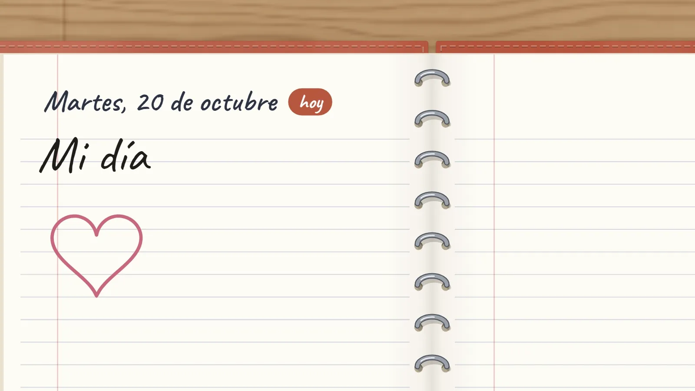
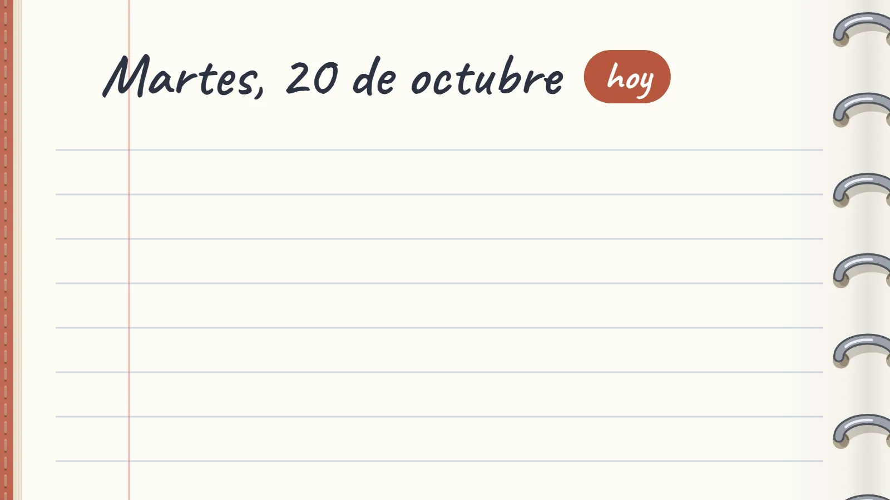
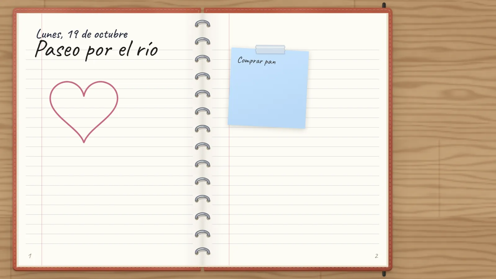
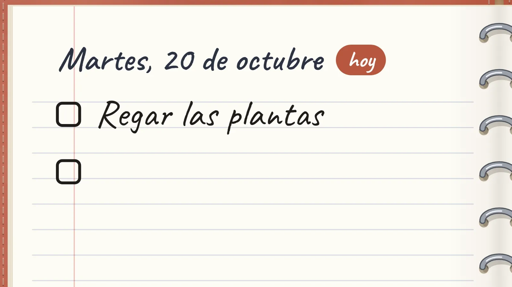
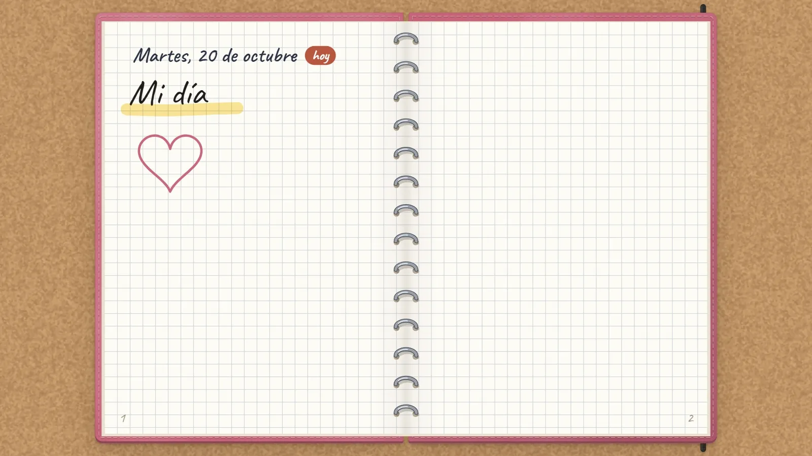
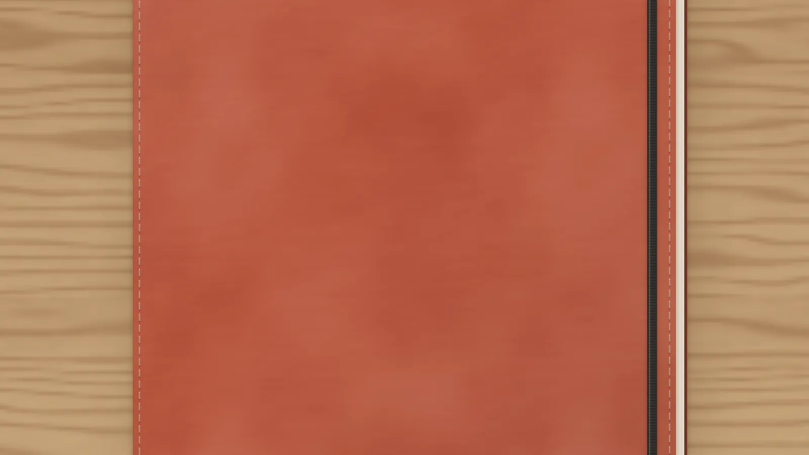
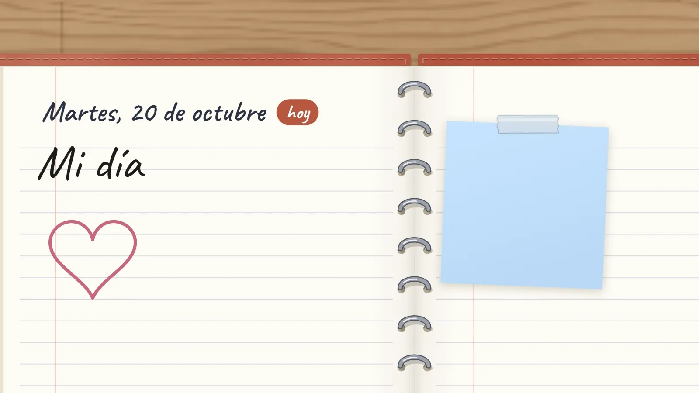
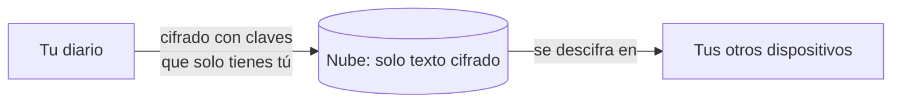
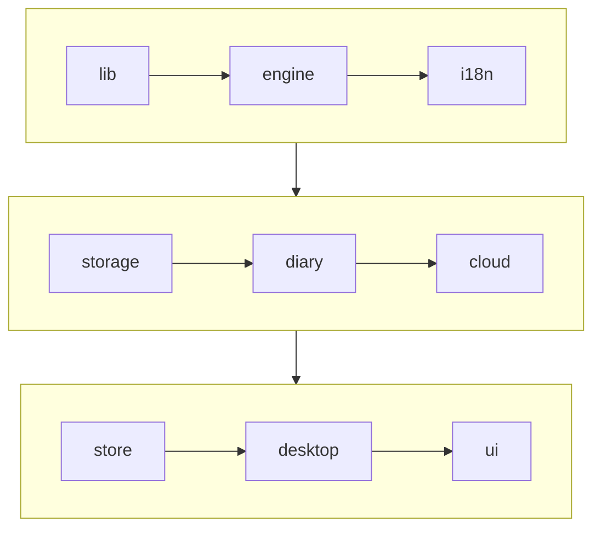

<div align="center">


# diaryo

**Cada día, una doble página infinita.**<br>
Un diario para escribir, dibujar, pegar notas y unir ideas, en tu PC o en el navegador.

[Web](https://diaryo.javiermateo.dev) ·
[Úsalo en el navegador](https://app.diaryo.javiermateo.dev) ·
[Descargar para Windows](https://github.com/javimateo/Diaryo/releases/latest)

[](https://github.com/javimateo/Diaryo/releases/latest)
[](https://github.com/javimateo/Diaryo/actions/workflows/ci.yml)
[](LICENSE)

[English](README.md) · **Español**



</div>

## Qué es

diaryo es un diario de verdad sin bordes: una doble página por día, que se pasa tirando
de la esquina, donde escribir, dibujar y pegar cosas en cualquier sitio. Vive en tu
ordenador, aparece sobre el escritorio con un atajo y guarda tus notas para ti. No hace
falta cuenta; si quieres una, el diario se sincroniza entre dispositivos, cifrado de
extremo a extremo.

## Funciones

<table>
<tr>
<td width="50%" valign="top">

<br><b>Escribe y dibuja donde quieras.</b> Lápiz, marcador, texto, notas adhesivas, formas
y flechas que siguen unidas a lo que conectan. Imágenes, grupos, capas y enlaces entre
páginas.
</td>
<td width="50%" valign="top">

<br><b>Un diario, y un escritorio alrededor.</b> Tira de la esquina para pasar la página.
Lo que queda fuera del libro está en el escritorio, compartido por todas las páginas.
</td>
</tr>
<tr>
<td valign="top">

<br><b>Tareas y citas.</b> Escribe <code>[]</code> para una casilla y <code>@</code> para
una fecha. Próximo reúne lo pendiente; la app de escritorio te lo recuerda, y todo puede
ir a tu calendario.
</td>
<td valign="top">

<br><b>A tu gusto.</b> Tapas de cuero, tela o cartón; papel de rayas, cuadrícula, puntos,
Cornell o agenda; escritorio de madera, corcho o lino. Tema claro y oscuro.
</td>
</tr>
<tr>
<td valign="top">

<br><b>Tu propia portada.</b> Decora el diario cerrado con fotos, notas y texto, o parte de
una plantilla.
</td>
<td valign="top">

<br><b>Notas privadas.</b> Marca una nota como privada y su texto se cifra: solo se ve con
la contraseña del diario.
</td>
</tr>
</table>

**En el escritorio de Windows**: el diario flota sobre todo con `Ctrl+Alt+D`, y el
escritorio y un mini diario de hoy viven en el propio escritorio (`Ctrl+Alt+N`). Icono
en la bandeja, copias diarias en una carpeta y actualizaciones automáticas.

**Además**: busca cualquier cosa con `Ctrl+K`, en español o inglés, y una app web que se
usa con el dedo en el móvil. Pulsa `?` en la app para ver todos los atajos.

## Privado desde el principio

- **Primero, en tu equipo.** El diario se guarda en tu ordenador (o en tu navegador, en la
  app web). Funciona sin conexión y sin cuenta.
- **Cifrado en el dispositivo, si quieres.** Una contraseña del diario puede cifrar las
  notas privadas o el diario entero en reposo (XChaCha20-Poly1305).
- **Una nube cifrada de extremo a extremo.** Con cuenta, todo se cifra antes de salir del
  dispositivo (AES-256-GCM, con claves que salen de tu contraseña del diario mediante
  PBKDF2). El servidor solo guarda texto cifrado con identificadores opacos: ni su
  administrador puede leer un diario. 50 MB gratis.
- **Tus datos son tuyos.** Guarda una copia en un archivo cuando quieras, descarga lo que
  el servidor sabe de ti o borra la cuenta con todo lo que tiene.



Cómo funciona, en detalle (en inglés): [sincronización en la nube](docs/cloud.md) y
[privacidad en el dispositivo](docs/privacy.md). ¿Has encontrado un fallo de seguridad?
Mira [SECURITY.md](SECURITY.md).

## Descargar

| Dónde               | Cómo                                                                                                          |
| ------------------- | ------------------------------------------------------------------------------------------------------------- |
| Windows 10 / 11     | El instalador de la [última versión](https://github.com/javimateo/Diaryo/releases/latest). Se actualiza solo. |
| Cualquier navegador | <https://app.diaryo.javiermateo.dev>, sin instalar nada. También en el móvil.                                 |

El instalador aún no está firmado, así que Windows SmartScreen avisa la primera vez: «Más
información» → «Ejecutar de todas formas» ([por qué](docs/releasing.md#the-windows-warning)).

## Ejecutarlo en local

Requisitos: [Node.js](https://nodejs.org) 22 o posterior.

```bash
npm install
npm run dev
```

Abre <http://localhost:5173>: es la app web.

<details>
<summary><b>La app de escritorio, la web y todos los scripts</b></summary>

La app de escritorio necesita además [Rust](https://rustup.rs) y las herramientas de C++
de Visual Studio (la carga «Desarrollo para el escritorio con C++»):

```bash
npm run desktop
```

Para generar el instalador (queda en `src-tauri/target/release/bundle/nsis`):

```bash
npm run desktop:build
```

La web (presentación, demo en vivo y descargas) está en `web/` y reutiliza el código de
la app, así que hacen falta las dos dependencias:

```bash
npm --prefix web install
npm --prefix web run dev
```

| Comando                    | Qué hace                                           |
| -------------------------- | -------------------------------------------------- |
| `npm run dev`              | Servidor de desarrollo de la app                   |
| `npm run build`            | Comprueba los tipos y genera la app web en `dist/` |
| `npm run desktop`          | Abre la app de escritorio (desarrollo)             |
| `npm run desktop:build`    | Genera el instalador de escritorio                 |
| `npm test`                 | Ejecuta las pruebas (Vitest)                       |
| `npm run lint`             | Revisa el código (ESLint)                          |
| `npm run format`           | Da formato a todo (Prettier)                       |
| `npm run media`            | Graba las animaciones del README desde el motor    |
| `npm --prefix web run dev` | Servidor de desarrollo de la web                   |

Para la nube, un PocketBase local: mira [CONTRIBUTING](CONTRIBUTING.md#the-cloud-locally).

</details>

## La arquitectura de un vistazo

Un único código en TypeScript funciona como app web, dentro de [Tauri](https://tauri.app)
como app de escritorio y en la demo en vivo de la web. El motor del lienzo es propio
(Canvas 2D, sin framework); React solo dibuja la interfaz que lo rodea.



Cada capa solo importa de las anteriores: el motor no sabe nada de React, ni el
almacenamiento de la nube. Más en [la documentación](docs/README.md) (en inglés):
[arquitectura](docs/architecture.md), [nube](docs/cloud.md),
[privacidad](docs/privacy.md), [tecnologías](docs/tech-stack.md),
[versiones](docs/releasing.md) y [despliegue](docs/deployment.md).

## Contribuir

Los informes de fallos, las ideas y las pull requests son bienvenidos. Lee antes
[CONTRIBUTING](CONTRIBUTING.md) (en inglés); para algo más grande que un arreglo pequeño,
abre primero un issue para hablarlo. Los fallos de seguridad se comunican en privado, como
explica [SECURITY.md](SECURITY.md). Lo que cambia en cada versión está en el
[CHANGELOG](CHANGELOG.md).

## Licencia

diaryo es de **código disponible** bajo la
[PolyForm Noncommercial License 1.0.0](LICENSE).

- ✅ **Puedes** leer, usar, modificar y compartir el código para cualquier fin no
  comercial: uso personal, estudio, investigación, proyectos por afición, ONG, centros
  educativos y organismos públicos.
- ❌ **No puedes** usarlo comercialmente: venderlo, incluirlo en un producto o servicio de
  pago, ni usarlo para ganar dinero.
- 💬 Para cualquier otra cosa, [escríbeme](https://github.com/javimateo).

No es una licencia «open source» en el sentido de la OSI, por esa condición no comercial.
Las bibliotecas y fuentes que usa diaryo mantienen sus propias licencias (mira las
[tecnologías](docs/tech-stack.md)).

Copyright © 2026 Javier Mateo.
