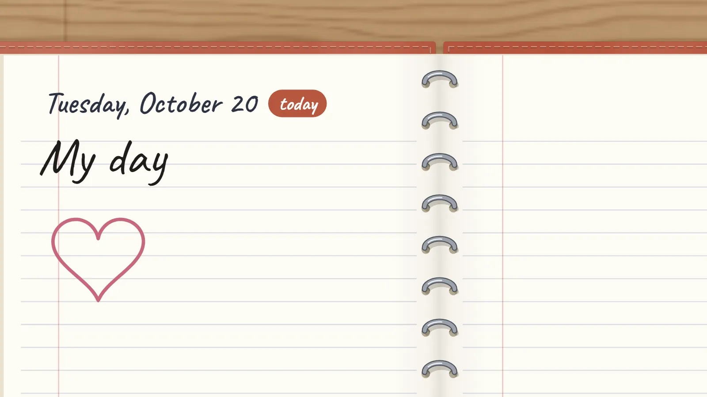
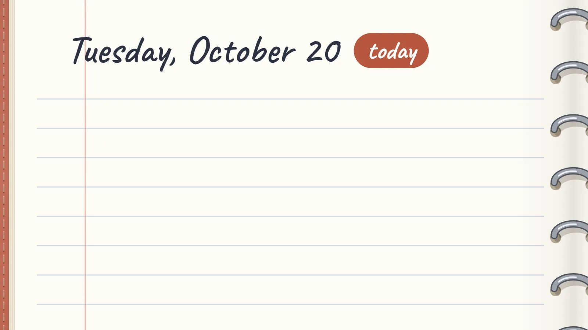
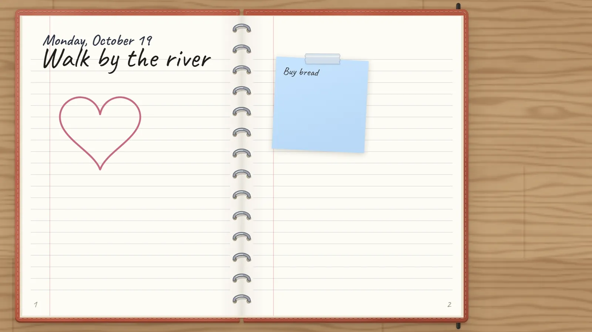
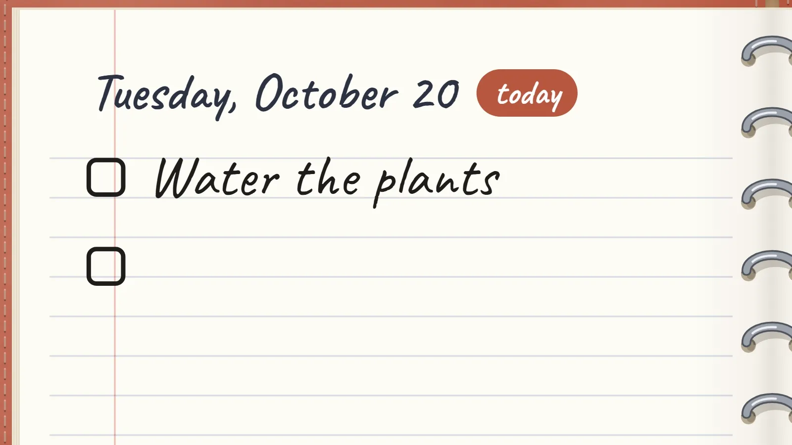
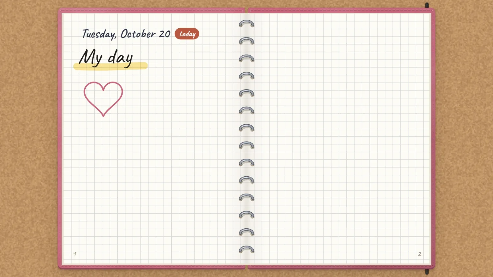
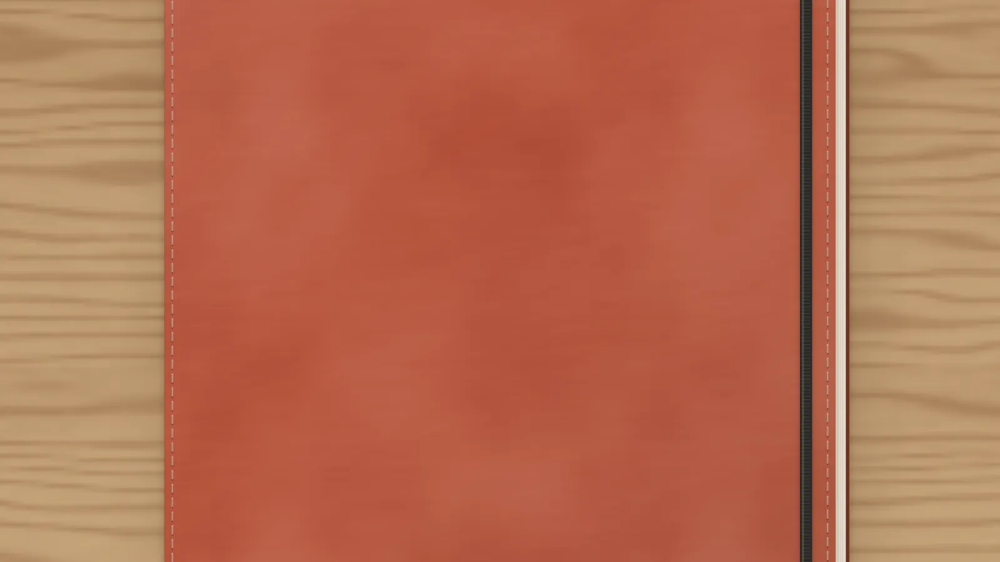
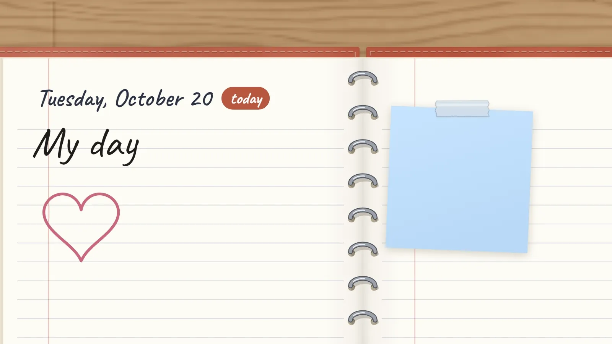
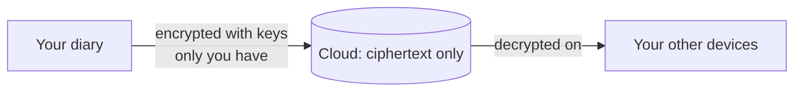
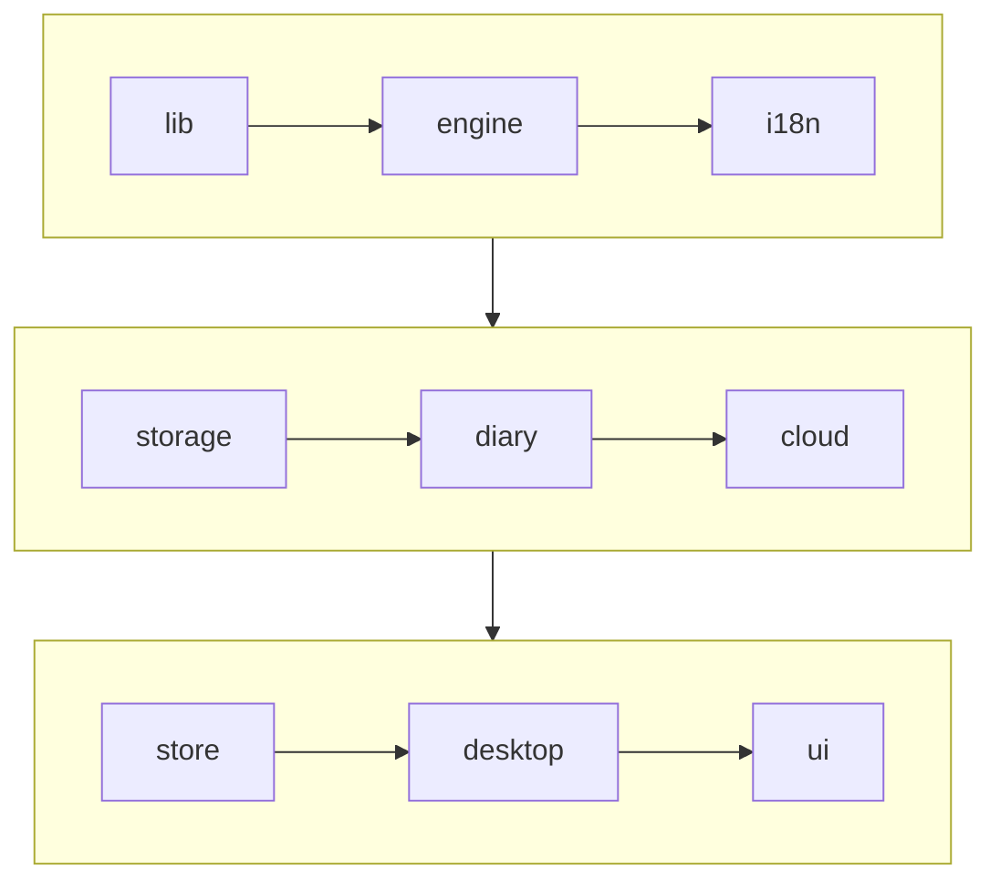

<div align="center">


# diaryo

**Every day, an infinite double page.**<br>
A diary to write, draw, stick notes and connect ideas, on your PC or in the browser.

[Website](https://diaryo.javiermateo.dev) ·
[Use it in the browser](https://app.diaryo.javiermateo.dev) ·
[Download for Windows](https://github.com/javimateo/Diaryo/releases/latest)

[](https://github.com/javimateo/Diaryo/releases/latest)
[](https://github.com/javimateo/Diaryo/actions/workflows/ci.yml)
[](LICENSE)

**English** · [Español](README.es.md)



</div>

## What it is

diaryo is a real diary with no edges: one double page per day, turned by pulling the
corner, where you can write, draw and stick things anywhere. It lives on your computer,
pops up over the desktop with a shortcut and keeps your notes to yourself. No account is
needed; if you want one, the diary syncs between devices, end-to-end encrypted.

## Features

<table>
<tr>
<td width="50%" valign="top">

<br><b>Write and draw anywhere.</b> Pencil, highlighter, text, sticky notes, shapes and
arrows that stay attached to what they join. Images, groups, layers and links between pages.
</td>
<td width="50%" valign="top">

<br><b>A diary, and a desk around it.</b> Pull the corner to turn the page. Whatever lies
outside the book is on the desk, shared by every page.
</td>
</tr>
<tr>
<td valign="top">

<br><b>Tasks and appointments.</b> Type <code>[]</code> for a checkbox and <code>@</code>
for a date. Upcoming lists what is pending; the desktop app reminds you, and anything
goes to your calendar.
</td>
<td valign="top">

<br><b>Make it yours.</b> Leather, cloth or cardboard covers; lined, grid, dotted, Cornell
or planner paper; a wood, cork or linen desk. Light and dark theme.
</td>
</tr>
<tr>
<td valign="top">

<br><b>Your own cover.</b> Decorate the closed diary with photos, notes and text, or
start from a template.
</td>
<td valign="top">

<br><b>Private notes.</b> Mark a note as private and its text is encrypted: it shows only
with your diary password.
</td>
</tr>
</table>

**On the Windows desktop**: the diary floats over everything with `Ctrl+Alt+D`, and the
desk and today's mini diary live on the desktop itself (`Ctrl+Alt+N`). Tray icon, daily
backups to a folder and automatic updates.

**Also**: search everything with `Ctrl+K`, English and Spanish, and a web app that works
with a finger on phones. Press `?` in the app to see every shortcut.

## Private by design

- **Local first.** The diary is saved on your computer (or in your browser, for the web
  app). It works offline and without an account.
- **Encrypted on the device, if you like.** One diary password can encrypt the private
  notes or the whole diary at rest (XChaCha20-Poly1305).
- **An end-to-end encrypted cloud.** With an account, everything is encrypted before it
  leaves the device (AES-256-GCM, keys from your diary password through PBKDF2). The
  server only stores ciphertext under opaque ids: not even its administrator can read a
  diary. 50 MB free.
- **Your data, yours.** Save a copy to a file at any time, download what the server knows
  about you, or delete the account and everything in it.



How it works, in detail: [cloud sync](docs/cloud.md) and
[privacy on the device](docs/privacy.md). Found a security issue? See
[SECURITY.md](SECURITY.md).

## Download

| Where           | How                                                                                                              |
| --------------- | ---------------------------------------------------------------------------------------------------------------- |
| Windows 10 / 11 | The installer from the [latest release](https://github.com/javimateo/Diaryo/releases/latest). It updates itself. |
| Any browser     | <https://app.diaryo.javiermateo.dev>, nothing to install. Works on phones too.                                   |

The installer isn't code-signed yet, so Windows SmartScreen warns the first time: "More
info" → "Run anyway" ([why](docs/releasing.md#the-windows-warning)).

## Running it locally

Requirements: [Node.js](https://nodejs.org) 22 or later.

```bash
npm install
npm run dev
```

Open <http://localhost:5173>: that is the web app.

<details>
<summary><b>The desktop app, the website and every script</b></summary>

The desktop app also needs [Rust](https://rustup.rs) and the Visual Studio C++ build
tools (the "Desktop development with C++" workload):

```bash
npm run desktop
```

To build the installer (it ends up in `src-tauri/target/release/bundle/nsis`):

```bash
npm run desktop:build
```

The website (presentation, live demo and downloads) lives in `web/` and reuses the app's
code, so both sets of dependencies are needed:

```bash
npm --prefix web install
npm --prefix web run dev
```

| Command                    | What it does                                    |
| -------------------------- | ----------------------------------------------- |
| `npm run dev`              | App development server                          |
| `npm run build`            | Type-checks and builds the web app in `dist/`   |
| `npm run desktop`          | Opens the desktop app (development)             |
| `npm run desktop:build`    | Builds the desktop installer                    |
| `npm test`                 | Runs the tests (Vitest)                         |
| `npm run lint`             | Lints the code (ESLint)                         |
| `npm run format`           | Formats everything (Prettier)                   |
| `npm run media`            | Records the README's animations from the engine |
| `npm --prefix web run dev` | Website development server                      |

For the cloud, a local PocketBase: see [CONTRIBUTING](CONTRIBUTING.md#the-cloud-locally).

</details>

## Architecture at a glance

One TypeScript codebase runs as the web app, inside [Tauri](https://tauri.app) as the
desktop app, and in the website's live demo. The canvas engine is our own (Canvas 2D, no
framework); React only draws the interface around it.



Each layer only imports from the ones before it: the engine knows nothing about React,
and storage nothing about the cloud. More in [the documentation](docs/README.md):
[architecture](docs/architecture.md), [cloud](docs/cloud.md),
[privacy](docs/privacy.md), [tech stack](docs/tech-stack.md),
[releasing](docs/releasing.md) and [deployment](docs/deployment.md).

## Contributing

Bug reports, ideas and pull requests are welcome. Read [CONTRIBUTING](CONTRIBUTING.md)
first; for anything bigger than a small fix, open an issue to talk about it. Security
issues go privately, as [SECURITY.md](SECURITY.md) explains. What changes in each
version is in the [CHANGELOG](CHANGELOG.md).

## License

diaryo is **source-available** under the [PolyForm Noncommercial License 1.0.0](LICENSE).

- ✅ **You may** read, use, change and share the code for any non-commercial purpose:
  personal use, study, research, hobby projects, charities, schools and public bodies.
- ❌ **You may not** use it commercially: sell it, include it in a paid product or
  service, or use it to make money.
- 💬 For anything else, [get in touch](https://github.com/javimateo).

It isn't an "open source" license in the OSI sense, because of that non-commercial
condition. The libraries and fonts diaryo uses keep their own licenses (see the
[tech stack](docs/tech-stack.md)).

Copyright © 2026 Javier Mateo.
